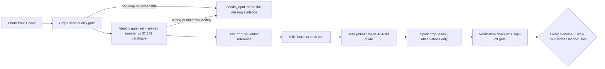

# Real or Replica — project "Fake Check"

**Multi-signal Meta-model verification for trading cards.** Not one photo
guess: identity lookup, pixel-level tells measured separately on the front
and the back, set-symbol verification, and Muse Spark reads — combined in
an agent loop that is allowed to say **Inconclusive**.

Live demo: **https://cardcauldrontcg.com/demo/**
Hackathon: Meta Global AI Developer Hackathon (Cerebral Valley), Indie Track
Submission deadline: **Wed Nov 4, 2026, 9:00 PM ET**

> **Honest status, up front.** The demo checker is labelled **SAMPLE** by
> design. Our calibration gate **failed** on Oct 28, 2026 (safe — 0
> confident-wrong answers — but not accurate enough to ship), so **no real
> verdict has ever shipped** and the numeric threshold is still **NONE
> SET**. What this repo proves is the pipeline, the evidence discipline,
> and the measurements — not a finished authenticity oracle.

---

## What it is

A card check runs four independent signals, and no single signal can
produce a verdict on its own:

1. **Identity first.** The card's printed set + number is matched against
   a 37,369-identity reference catalogue (EN 23,771 / 223 sets, JA 13,598
   / 346 sets, built from TCGdex data — `data/tcgdex-details/`). A
   reference for the *wrong* identity yields Inconclusive, never Genuine.
2. **Pixel tells, front and back separately.** Five measurements (aspect,
   colour, border, edge, histogram) are taken the same way on the user's
   photo and on a verified reference, and on the card's back against a
   175-back pool (`data/databases/`). Rule: ≥2 strong mismatches → Likely
   Counterfeit; 0 strong + ≥3 matches → Likely Genuine; otherwise
   Inconclusive.
3. **Set-symbol gate.** A set label counts only when the set symbol
   printed at the bottom of the card's own front photo matches the
   404-set symbol guide (`data/set-symbol-guide/`). Catalogue fill alone
   is provisional — 51 older English sets never printed a symbol and are
   identified by number + era instead.
4. **Muse Spark reads.** Spark reads structured crops (number strip,
   set-symbol corner, holo window, full front/back) and returns per-tell
   *observations*. Model output is advisory evidence for calibration —
   it never overwrites a label and never issues a verdict.

## The pipeline



The same flow in plain text: **photo → crop & quality gate → identity
gate → front tells → back tells → set-symbol gate → Spark observations →
verification checklist → one of three outcomes.** Any gate can stop the
check with `needs_input`, which names the exact missing evidence (a back
photo, a slab cert, a readable crop) instead of guessing. Every Likely
verdict is an estimate only — never an official grade, never a guarantee.

## What was pre-existing vs built during the event

Hackathon compliance: only **Oct 26 – Nov 4, 2026** work is claimed for
this event.

| | What |
|---|---|
| **Pre-existing (NOT claimed)** | The idea itself; Card Cauldron TCG (the builder's real card shop); the website; the first demo (Oct 24–25, 2026); the card photos and scans used as ground truth (shot before the event — the event work is the labelling, verification, and systems built *around* them). |
| **Built Oct 26–27** | Checker core: agent loop v2, tells v2, crop v2, identity wiring to the 37,369 catalogue, back pool (175), Agents 101 verification gate / needs_input / timeline. |
| **Built Oct 28** | Image-to-identity matcher prototype, backend-tie test implementation, calibration run 1 (**gate FAIL** — reported, not hidden), verification pool v2 (229 owner-confirmed rows), live home-server backend (leaderboards, pool opt-in with photo storage, feedback), labelling guide. |
| **Built Oct 29** | Set-symbol guide (404 sets), overnight scan labelling (847 labelled / 91 honestly held of 938), 1,555-row master library, async SAM → Spark pipeline prototype, rules-memory recall eval, cross-route agreement study ("digital copies"). |
| **Oct 30 – Nov 4** | Calibration re-run on confirmed cards, final freeze, submission assembly. (This README is a living document until the Nov 4 freeze.) |

## Repository map

| Path | What it is |
|---|---|
| `checker/` | The V2 checker: `app_check_v2.py` (orchestrator), `agent_loop_v2.py`, `tells_v2.py`, `crop_v2.py`, `agents101_leftovers.py` (plan / exact-evidence facts / slab check / resumable checks), `why_measured.py` (plain-words why), `back_pool_crops.py`, `back_pool_score_crops.py`, `meta_pipeline.py` (reference code — needs Muse connector infrastructure, see Limitations). |
| `demo/` | The V2 local demo UI + server from Oct 27 (the live demo at cardcauldrontcg.com/demo is a separate, larger build). |
| `backend-matcher/` | Image-to-identity matcher prototype (aHash/dHash/pHash, two-gate rule) + its test results and the *unapproved* threshold proposal. |
| `backend-tie-impl/` | Backend-tie Steps 1–3 test implementation + Step 4a calibration report (gate FAIL). Localhost test code, never deployed as a verdict service. |
| `data/` | TCGdex detail index (37,369), backs/fronts indexes, verification pool v2 (229 rows, filenames only — no card photos), back-pool scores, set-symbol guide (404 sets). |
| `labelling/` | Set-fill code + its test, the progress ledger, and labelled dataset v3 (filenames only). |
| `docs/` | Dated reports: tells calibration, Agents 101 build order, demo checklist, backend-tie plan, GitHub sweep, labelling guide, agent-loop run reports. |
| `tests/` | Canned checker test results (JSON) + the unit tests described below. |

No API keys, tokens, credentials, or card photos are in this repo.
Ground-truth data stays private by design; indexes list filenames only.

## Setup & run (verified Oct 29, 2026 — including what does NOT run yet)

Prerequisites: Python 3.11+ (tested on 3.12.3) and
`pip install pillow numpy scipy`.

### What runs today, exactly as written

```bash
# 1. Everything compiles
python3 -m compileall checker demo backend-matcher backend-tie-impl labelling tests

# 2. Unit tests — NOTE the PYTHONPATH: the tests import modules from checker/
PYTHONPATH=checker python3 tests/test_why_measured_2026-10-28.py
#    → PASS (its checker-integration section SKIPs itself honestly:
#      the canned crop/reference images are not bundled in this repo)
PYTHONPATH=checker python3 tests/test_back_pool_score_crops.py
#    → 6/6 unittest cases OK (synthetic measures, no image I/O)

# 3. The checker CLI itself ($0, no API calls, writes result.json + progress)
python3 checker/app_check_v2.py --help
python3 checker/app_check_v2.py --user FRONT.png --reference REF.png \
    --identity "Name|Set|Number" --reference-identity "Name|Set|Number" \
    --crop-mode supplied --out /tmp/check-out
#    → runs end-to-end, but see Limitation 1: from this repo alone the
#      scan-quality gate module is missing, so every check currently
#      ends Inconclusive / needs_input before tells are measured.
```

### Known limitations — read this before judging the run

This is the section most READMEs would hide. Each item was verified by
actually running the code from a clean copy of this repo on Oct 29, 2026:

1. **The checker can't measure tells from this repo alone — yet.**
   `app_check_v2.py` imports `quality_gate` (and, on other paths,
   `multi_reference`, `identity_lookup`); those modules exist in the
   builder's playground but are **not in this repo yet** (some were
   excluded as scope decisions and are being re-decided). The failure
   degrades honestly — Inconclusive + "retake a clear photo", never a
   guessed verdict — but a measured verdict needs those files added.
   The canned results in `tests/*.json` were produced with the full
   module set present.
2. **`tests/test_back_pool_crops.py` cannot run standalone**:
   `crop_v2.py` imports `on_device_crop`, also not yet in this repo.
3. **`demo/server.py` and `demo/run_tests.py` are not standalone**:
   they import `identity_lookup` / `reference_registry` /
   `owner_scan_registry` and hardcode the builder's workspace paths.
   Use the live demo link above instead.
4. **`backend-matcher/test_matcher.py` is workspace-only**: it reads
   the verification pool and photos from the builder's local paths.
   Its committed `test_results.json` + `TEST_REPORT.md` are the
   portable evidence.
5. **`labelling/test_set_fill.py` points at files outside this repo**
   (the v2 dataset folder and a generated results CSV). The v3 dataset
   it should test is in `labelling/`; the test needs repointing.
6. **`backend-tie-impl/` needs its own venv** (fastapi, uvicorn,
   pydantic): its README names a machine-local venv path, and its
   `matcher.py` also imports the missing `identity_lookup`. Its
   `REPORT.md` and calibration JSON are the portable evidence.
7. **`checker/meta_pipeline.py` is reference code, not a runnable
   entry point**: it calls Meta/Baseten/SAM through Muse connector
   infrastructure that isn't part of this repo. `checker/run_demo.py`
   drives it and likewise isn't an offline test.
8. **`data/set-symbol-guide/build_guide.py` fetches live from
   api.tcgdex.net** — its outputs are committed, so you don't need to.

The fix list is short and mechanical (bundle the missing modules, fix
three `sys.path`s, repoint two tests, add fixtures + a requirements
file). It is scheduled before the Nov 4 freeze; until it lands, this
section stays.

## Evidence

**In this repo:**

- `tests/*.json` + `checker/README.md` — canned checker tests A–D
  (same-card Genuine, cross-identity Inconclusive, bad-crop refusal
  found-and-fixed, missing-reference offline fallback), all $0.
- `docs/tells-calibration-accuracy-2026-10-27.md` — tells calibration
  diagnostic (labelled as a matched-pairs diagnostic, not product
  accuracy).
- `backend-tie-impl/REPORT.md` + `calibration-report-2026-10-28.json`
  — the Oct 28 calibration gate **FAIL**, with the numbers.
- `backend-matcher/TEST_REPORT.md` + `test_results.json` — matcher
  distances; `THRESHOLD_PROPOSAL.md` is a proposal only, **not** an
  approved threshold.
- `data/back-pool-scores/` — back-pool scoring runs (genuine + fake).
- `labelling/PROGRESS-2026-10-29.md` — the labelling ledger: counts,
  holds, and the rule that no label counts until reviewed.
- `docs/agent-loop-run-*.md` — dated agent-loop run reports.

**Produced Oct 29, in the project record, not yet in this repo**
(scope decision pending — card-photo crops and spend logs are excluded
from this pack by policy, so these land as reports or not at all):

- **Recall eval** — does persistent rules-memory change agent
  behaviour? Adjudicated: rule violations **13/48 (27.1%) with memory
  OFF → 0/48 with memory ON** (96 runs, Baseten Spark Open, ~$3.70).
- **Async pipeline** — SAM → Spark as async jobs: **7/7 jobs complete**,
  13.4–24.6 s per full front+back check vs 46.8 s for the same job as
  one sequential call; total test spend ~$0.27.
- **Credit-burn reads** — Spark symbol-gate pass over 793 of 1,131
  pending rows (flags only, no labels changed), 40 structured
  calibration reads, 60 skeptic re-checks (56 agree / 4 questioned).
- **Digital copies** — cross-route agreement on 241 confirmed cards:
  63.8% overall; holo-pattern tell 92.4% (the portable tell), lettering
  38.2%, and the FP4 route measurably harsher. Two quantizations of one
  model family are correlated eyes — this does **not** satisfy the
  project's physical-copies median rule, and the report says so.

## Hard rules (enforced in code, not just promised)

- Identity gate first; a name/manifest match alone never yields Genuine.
- A bad crop is refused and escalated — never scored, never called fake.
- Inconclusive is a real answer and is never upgraded by the UI.
- No grade is ever guessed; a Likely verdict is an estimate only.
- SAM is escalation-only and a SAM box never authenticates anything.
- Model reads are observations; they never overwrite a human label.
- Pending/pool material is never calibration, training data, or a verdict.

## Built by

Sabastian Caudill — Card Cauldron TCG (solo indie builder; a real card
shop whose own confirmed cards and scans are the project's ground truth).
